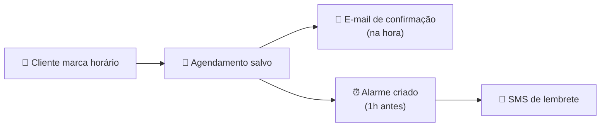
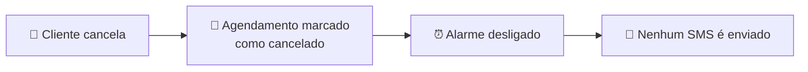
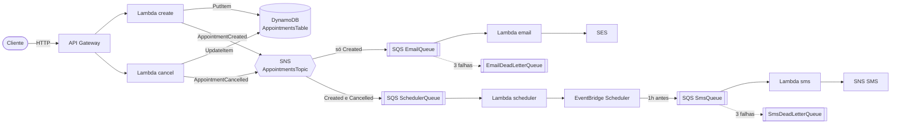
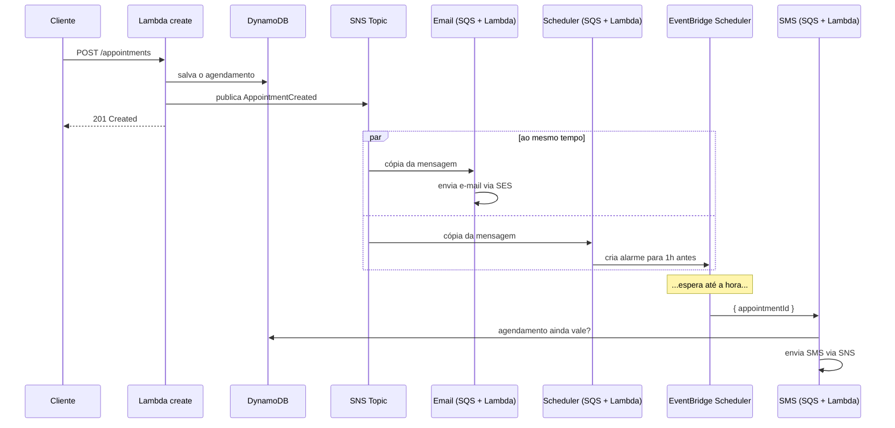

# aws-studies

API de agendamento de uma barbearia, feita para estudar AWS (com SST).

```bash
npm install
npx sst dev
```

## Como funciona

A ideia é simples: o cliente marca um horário, recebe um **e-mail** confirmando
e, **1 hora antes**, recebe um **SMS** lembrando.



Pensa assim:

1. **O cliente marca o horário.** A API anota o agendamento no caderno (banco de dados).
2. **A API grita "tem agendamento novo!"** num megafone (tópico SNS). Ela não espera ninguém responder — só avisa e já devolve a resposta pro cliente.
3. **Dois ajudantes estão ouvindo o megafone**, cada um com sua própria fila de tarefas:
   - o **ajudante do e-mail** manda na hora o e-mail de "seu horário está confirmado";
   - o **ajudante do alarme** programa um despertador para tocar 1 hora antes do horário.
4. **Quando o despertador toca**, o **ajudante do SMS** confere no caderno se o agendamento ainda vale e manda o lembrete por SMS.

### E se o cliente cancelar?



O agendamento fica marcado como cancelado e o ajudante do alarme desliga o
despertador. Se por acaso o despertador tocar mesmo assim, o ajudante do SMS
olha o caderno, vê que foi cancelado e não manda nada.

### Quem é quem na AWS

| Na historinha | Na AWS | Onde está |
|---|---|---|
| Porta de entrada da API | API Gateway + Lambda | [src/api/](src/api/) |
| Caderno | DynamoDB | [src/infra/database.ts](src/infra/database.ts) |
| Megafone | SNS (tópico) | [src/infra/topic.ts](src/infra/topic.ts) |
| Fila de tarefas de cada ajudante | SQS | [src/infra/queue.ts](src/infra/queue.ts) |
| Ajudante do e-mail | Lambda + SES | [src/workers/email.ts](src/workers/email.ts) |
| Ajudante do alarme | Lambda + EventBridge Scheduler | [src/workers/scheduler.ts](src/workers/scheduler.ts) |
| Ajudante do SMS | Lambda + SNS (SMS) | [src/workers/sms.ts](src/workers/sms.ts) |

### Dois cuidados extras

- **Ninguém recebe mensagem repetida.** Antes de enviar, o ajudante anota "já estou cuidando disso" numa lista (tabela `NotificationsTable`). Se a mesma tarefa chegar de novo, ele vê a anotação e pula.
- **Se der erro, tenta de novo.** Uma tarefa que falha volta pra fila e é tentada até 3 vezes. Se falhar sempre, vai pra uma "caixa de problemas" (DLQ) para alguém olhar depois.

## Rotas

| Método | Rota | O que faz |
|---|---|---|
| `GET` | `/health` | Verifica se a API está de pé |
| `POST` | `/appointments` | Cria um agendamento |
| `GET` | `/appointments` | Lista os agendamentos |
| `POST` | `/appointments/{id}/cancel` | Cancela um agendamento |

Exemplos prontos em [aws-studies.http](aws-studies.http).

---

## Por dentro: como funciona de verdade

A historinha lá de cima, agora com os nomes reais de cada peça.



E a mesma coisa vista no tempo, do `POST` até o SMS:



O ponto principal: **a API responde `201` logo depois de publicar no SNS**. E-mail, alarme e
SMS acontecem depois, em segundo plano. Se o SES estiver lento ou fora do ar, o cliente
nem percebe: a mensagem fica esperando na fila.

### SNS: o megafone (pub/sub)

O SNS (Simple Notification Service) é um serviço de **publicar e assinar**. A API publica
uma mensagem num **tópico** (`AppointmentsTopic`) e o SNS entrega **uma cópia para cada
assinante**. Isso se chama *fan-out*.

A API não sabe quem está ouvindo. Para criar um novo efeito colateral (um WhatsApp, por
exemplo), basta assinar o tópico. [create.ts](src/api/appointments/create.ts) não muda.

Cada mensagem leva um atributo `type`:

```ts
MessageAttributes: {
  type: { DataType: "String", StringValue: "AppointmentCreated" },
}
```

Esse atributo existe para o **filtro de assinatura**. Cada fila escolhe o que quer receber
([queue.ts](src/infra/queue.ts)):

| Assinante | Recebe |
|---|---|
| `EmailQueue` | só `AppointmentCreated` |
| `SchedulerQueue` | `AppointmentCreated` e `AppointmentCancelled` |

O filtro roda dentro do SNS: um cancelamento nem chega na fila de e-mail, e a Lambda de
e-mail não é chamada à toa.

### SQS: as filas de tarefas

O SQS (Simple Queue Service) é uma **fila de mensagens**. Por que não ligar o SNS direto
numa Lambda? A fila no meio garante três coisas:

- **Nada se perde:** se a Lambda falhar ou estiver ocupada, a mensagem continua na fila.
- **Retentativa automática:** uma mensagem que não foi processada volta para a fila e é tentada de novo.
- **Controle de ritmo:** a Lambda puxa mensagens em lotes, no ritmo dela, sem ser atropelada num pico.

**Como a Lambda lê a fila.** Você não chama a Lambda: a própria AWS fica consultando a
fila (*event source mapping*) e chama a Lambda com um **lote** de mensagens em
`event.Records`. Enquanto uma mensagem está sendo processada, ela fica **invisível** para os
outros (*visibility timeout*). Se der certo, é apagada. Se der erro, ela reaparece e é
tentada de novo.

**Falha parcial do lote.** As filas usam `batch: { partialResponses: true }`. Se num lote
de 10 mensagens só uma falhar, a Lambda devolve só o id dela:

```ts
return { batchItemFailures: [{ itemIdentifier: record.messageId }] };
```

Só essa volta para a fila. As outras 9 são apagadas e ninguém recebe e-mail repetido por
causa de uma vizinha que falhou.

**DLQ (Dead Letter Queue).** `EmailQueue` e `SmsQueue` têm `retry: 3`. Uma mensagem que
falha 3 vezes vai para `EmailDeadLetterQueue` ou `SmsDeadLetterQueue`, a "caixa de
problemas". Ela fica lá parada, para alguém investigar, em vez de tentar para sempre.

> A `SchedulerQueue` não tem DLQ. Uma mensagem que falha sempre fica sendo retentada até
> expirar pela retenção da fila (4 dias, o padrão do SQS).

**O envelope do SNS.** Quando o SNS entrega numa fila, ele embrulha a mensagem original
num JSON dele:

```json
{
  "Type": "Notification",
  "TopicArn": "arn:aws:sns:us-east-1:...:AppointmentsTopic",
  "Message": "{\"type\":\"AppointmentCreated\",\"data\":{...}}",
  "MessageAttributes": { "type": { "Type": "String", "Value": "AppointmentCreated" } }
}
```

Por isso os workers de e-mail e de scheduler fazem **dois** `JSON.parse`: um para abrir o
envelope (`record.body`) e outro para ler a mensagem de verdade (`envelope.Message`). O
worker de SMS faz só **um**, porque quem escreve na `SmsQueue` é o EventBridge Scheduler,
que manda o JSON puro `{ "appointmentId": "..." }`.

### SES: o envio de e-mail

O SES (Simple Email Service) é o serviço de e-mail da AWS. O worker
([email.ts](src/workers/email.ts)) monta e manda o e-mail com `SendEmailCommand`, em duas
versões: **texto** e **HTML**. O cliente de e-mail mostra a que conseguir.

- **Remetente verificado:** `sst.aws.Email` ([email.ts](src/infra/email.ts)) registra `izakdvlpr@gmail.com` como identidade no SES. A AWS manda um link de confirmação, e enquanto ninguém clicar o SES recusa o envio.
- **Sandbox:** contas novas começam no sandbox do SES, onde **o destinatário também precisa estar verificado**. Para mandar para qualquer pessoa, é preciso pedir à AWS a saída do sandbox (*production access*).
- **`escapeHtml`:** o nome do cliente vem do usuário. Ele é escapado antes de entrar no HTML para ninguém injetar tags no e-mail.

### EventBridge Scheduler: o despertador

O EventBridge Scheduler agenda uma ação para um momento exato. O worker
([scheduler.ts](src/workers/scheduler.ts)) cria um **schedule de execução única** para cada
agendamento:

| Campo | Valor | Por quê |
|---|---|---|
| `Name` | `reminder-<id>` | Nome previsível: é assim que o cancelamento acha o alarme para apagar |
| `ScheduleExpression` | `at(2026-10-23T17:02:00)` | Executa uma vez só, nesse horário |
| `ScheduleExpressionTimezone` | `America/Sao_Paulo` | `at()` não aceita offset, então o fuso vai separado |
| `ActionAfterCompletion` | `DELETE` | Depois de tocar, o alarme se apaga sozinho |
| `Target` | `SmsQueue` + `{ appointmentId }` | Na hora, ele coloca essa mensagem na fila do SMS |

Casos especiais tratados:

- **Menos de 1h para o horário:** o alarme nem é criado, porque o lembrete já estaria no passado.
- **`ConflictException`:** o alarme já existe porque a mesma mensagem chegou duas vezes. É ignorado.
- **`ResourceNotFoundException` no cancelamento:** o alarme já tocou (e se apagou) ou nunca foi criado. É ignorado.

**Permissões.** O Scheduler roda **fora** da Lambda, então precisa da própria identidade
IAM (`ReminderSchedulerRole`), que só pode fazer `sqs:SendMessage` na `SmsQueue`. A Lambda
scheduler, por sua vez, precisa de `iam:PassRole` para entregar essa role ao Scheduler na
criação do alarme. Os alarmes ficam num grupo próprio
(`aws-studies-<stage>-reminders`) para não se misturar com outros projetos da conta.

### SNS de novo: o envio de SMS

O mesmo SNS do megafone também manda SMS, mas aqui **sem tópico**: o worker
([sms.ts](src/workers/sms.ts)) publica direto num número de telefone.

```ts
new PublishCommand({
  PhoneNumber: "+5531...",
  Message: "Barbearia do Jose: lembrete, seu horario de ...",
  MessageAttributes: {
    "AWS.SNS.SMS.SMSType": { DataType: "String", StringValue: "Transactional" },
  },
});
```

- **`Transactional`:** marca o SMS como importante (não é marketing). A AWS prioriza a entrega.
- **Busca de novo no banco:** a mensagem do Scheduler só traz o `id`. O worker lê o agendamento atual no DynamoDB, porque ele pode ter sido cancelado depois que o alarme foi criado.
- **Sandbox de SMS:** contas novas só mandam SMS para números verificados no console do SNS. A AWS também impõe um limite de gasto mensal (por padrão, US$ 1).
- **Sem acento na mensagem:** um SMS com acento usa outra codificação e cabe menos texto em cada parte.

### Como não mandar mensagem repetida

O SQS entrega **pelo menos uma vez**: em casos raros, a mesma mensagem chega duas vezes.
Para isso não virar e-mail ou SMS duplicado, os workers usam a `NotificationsTable`
([delivery.ts](src/utils/delivery.ts)):

1. **`reserveDelivery`**: grava `<id>#confirmation` (ou `<id>#reminder`) com a condição "só se ainda não existir". Se já existe, outro processamento já cuidou disso e o worker pula.
2. **Envia** o e-mail ou SMS.
3. **Deu erro no envio?** `releaseReservation` apaga a reserva para a retentativa conseguir enviar.
4. **Deu certo?** `markAsSent` marca como `sent`.

A condição "só se não existir" é atômica no DynamoDB: se duas Lambdas tentarem ao mesmo
tempo, só uma ganha.

### O fluxo de cancelamento por dentro

1. [cancel.ts](src/api/appointments/cancel.ts) faz um `UpdateItem` **condicional**: só marca `status = cancelled` se o agendamento existir e ainda não estiver cancelado.
   - Não existe → `404`.
   - Já cancelado → `409`.
2. Publica `AppointmentCancelled` no tópico.
3. Só a `SchedulerQueue` recebe esse evento (filtro). O worker apaga o alarme `reminder-<id>`.
4. **Rede de segurança:** se o alarme já tinha disparado e a mensagem está na `SmsQueue`, o worker de SMS lê o banco, vê `cancelled` e não envia.

### Como a infraestrutura é criada (SST)

Tudo é declarado em TypeScript e o SST cria na AWS. A ordem está em
[sst.config.ts](sst.config.ts): primeiro [queue.ts](src/infra/queue.ts) (que puxa tabelas,
tópico e e-mail), depois [api.ts](src/infra/api.ts).

| Recurso | Componente | Arquivo |
|---|---|---|
| Tabelas `AppointmentsTable` e `NotificationsTable` | `sst.aws.Dynamo` | [database.ts](src/infra/database.ts) |
| Tópico `AppointmentsTopic` | `sst.aws.SnsTopic` | [topic.ts](src/infra/topic.ts) |
| Remetente de e-mail | `sst.aws.Email` | [email.ts](src/infra/email.ts) |
| Filas, DLQs e workers | `sst.aws.Queue` | [queue.ts](src/infra/queue.ts) |
| Grupo e role do Scheduler | `aws.scheduler.*`, `aws.iam.*` | [queue.ts](src/infra/queue.ts) |
| API e rotas | `sst.aws.ApiGatewayV2` | [api.ts](src/infra/api.ts) |

Três ideias do SST que aparecem no código:

- **`link`:** ligar um recurso a uma Lambda (`link: [appointmentsTable]`) faz duas coisas: dá a permissão IAM e deixa o recurso acessível no código via `Resource.AppointmentsTable.name`. Nada de nome de tabela fixo no código.
- **`queue.subscribe(...)`:** cria a Lambda worker e o *event source mapping* que faz a AWS consultar a fila e chamar a Lambda.
- **`topic.subscribeQueue(...)`:** cria a assinatura do SNS na fila (com o filtro) e a *queue policy* que autoriza o SNS a escrever nela.

O SST não tem componente pronto para o EventBridge Scheduler. Por isso essa parte usa os
recursos crus do provider AWS (`aws.scheduler.ScheduleGroup`, `aws.iam.Role`), com as
permissões escritas à mão. As informações chegam ao worker por `environment`, em vez de
`link`.
